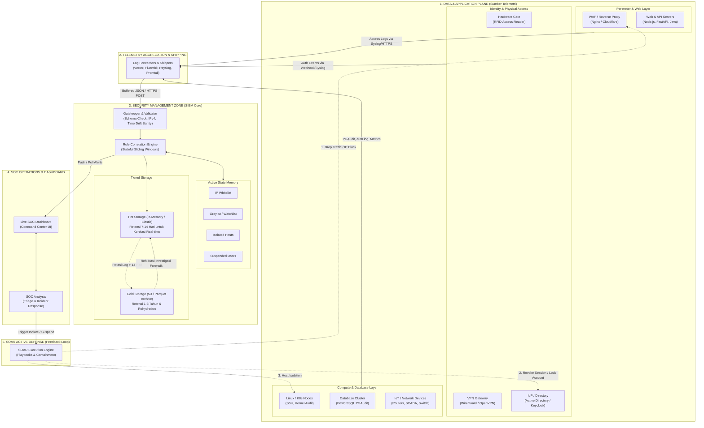

# 🛡️ Mini-SIEM Simulator (V2.1 - Real Log Replay & SOAR Active Defense Edition)

Aplikasi simulasi **Security Information and Event Management (SIEM)** berskala kecil berbasis API yang dibangun menggunakan **FastAPI**, **Pydantic**, dan **HTML5/CSS3/Vanilla JS (SOC Dark Command Center)**.

Sistem ini mendemonstrasikan secara *real-time* bagaimana pusat komando operasi keamanan (SOC):
1. Menerima, memvalidasi, dan menormalisasi log telemetri (*Gatekeeper Ingestion*).
2. Membaca format berkas log fisik autentik dunia nyata (Nginx Combined, Linux Syslog, CSV, PGAudit JSONL) via Universal Log Adapter.
3. Mendeteksi anomali dan serangan siber melalui mesin korelasi berbasis aturan (*Rule-based Correlation Engine*).
4. Mengurangi *Alert Fatigue* dengan debouncing cerdas.
5. Memitigasi data kotor dan *Time Drift Error* (HTTP 422).
6. Memvisualisasikan bahaya fatal dari **Careless Whitelisting** (celah *Blind Spot* buatan).
7. Menjawab tantangan *Hot vs Cold Storage* dan mendeteksi serangan **Low & Slow APT** melintasi rentang waktu 20 hari.
8. **SOAR Active Defense & Containment Playbook**: Memungkinkan analis mengisolasi host yang disusupi (*Network Quarantine*) dengan satu klik, memutus total traffic lanjutan di pintu Gatekeeper (**HTTP 403 Forbidden**).

---

## 📋 Daftar Isi
1. [Spesifikasi Kontrak Data](#-spesifikasi-kontrak-data)
2. [5 Aturan Mesin Korelasi & Logika APT](#-5-aturan-mesin-korelasi--logika-apt)
3. [SOAR Active Defense & Host Containment](#-soar-active-defense--host-containment)
4. [Topologi Penempatan SIEM & Peran Lapisan dalam Ekosistem](#-topologi-penempatan-siem--peran-lapisan-dalam-ekosistem)
5. [Arsitektur Log Adapter & Matriks 24 Varian Berkas Sample Logs](#-arsitektur-log-adapter--matriks-24-varian-berkas-sample-logs)
6. [Instalasi & Persiapan Lingkungan](#-instalasi--persiapan-lingkungan)
7. [Menjalankan Server & Dashboard](#-menjalankan-server--dashboard)
8. [Panduan Step-by-Step Menjalankan PoC Skenario 1 s/d 8](#-panduan-step-by-step-menjalankan-poc-skenario-1-sd-8)
   - [Skenario 1: Trafik Normal (Baseline)](#skenario-1-trafik-normal-baseline)
   - [Skenario 2: DDoS / Botnet Attack (Rule 1 - TINGGI)](#skenario-2-ddos--botnet-attack-rule-1---tinggi)
   - [Skenario 3: Impossible Travel (Rule 2 - KRITIS)](#skenario-3-impossible-travel-rule-2---kritis)
   - [Skenario 4: Distributed Brute Force (Rule 3 - TINGGI)](#skenario-4-distributed-brute-force-rule-3---tinggi)
   - [Skenario 5: Data Exfiltration / Insider Threat (Rule 5 - KRITIS)](#skenario-5-data-exfiltration--insider-threat-rule-5---kritis)
   - [Skenario 6: Careless Whitelisting (Fatal Error / Blind Spot Demo)](#skenario-6-careless-whitelisting-fatal-error--blind-spot-demo)
   - [Skenario 7: Data Cacat & Time Drift (Gatekeeper Negative Testing)](#skenario-7-data-cacat--time-drift-gatekeeper-negative-testing)
   - [Skenario 8: The Low & Slow APT (Hot vs Cold Storage & Greylist Demo)](#skenario-8-the-low--slow-apt-hot-vs-cold-storage--greylist-demo)
   - [Skenario 9: OT Hardware Sabotage - AC Central Datacenter Shutdown (MQTT)](#skenario-9-ot-hardware-sabotage---ac-central-datacenter-shutdown-mqtt)
   - [Demo SOAR: Host Isolation & Active Traffic Dropping](#demo-soar-host-isolation--active-traffic-dropping)
9. [Otomasi Pengujian (Automated Unit & Integration Tests - 29 Passed)](#-otomasi-pengujian-automated-unit--integration-tests---29-passed)
10. [Daftar Endpoint API SIEM & SOAR](#-daftar-endpoint-api-siem--soar)
11. [Struktur Direktori Proyek](#-struktur-direktori-proyek)

---

## 📑 Spesifikasi Kontrak Data
Setiap log yang dikirim ke `POST /api/ingest` wajib memenuhi format JSON kanonikal berikut:

```json
{
  "timestamp": "2026-10-19T16:22:43Z",
  "event_type": "login_attempt | web_request | database_download",
  "user_id": "string (non-empty)",
  "ip_address": "string (IPv4 format)",
  "location": "string (non-empty)",
  "status": "success | failed"
}
```

*Jika data tidak mematuhi kontrak atau mengalami selisih waktu > 24 jam / masa depan, sistem merespons dengan **HTTP 422 (Unprocessable Entity)**. Jika IP pengirim sedang berada dalam status **Network Quarantine (SOAR)**, Gatekeeper langsung menolak dengan **HTTP 403 (Forbidden)**.*

---

## 🧠 5 Aturan Mesin Korelasi & Logika APT
| ID Aturan | Nama Aturan | Tingkat Keparahan | Logika / Kondisi Pemicu |
| :--- | :--- | :--- | :--- |
| **Rule 1** | **DDoS / Botnet** | **TINGGI** | > 10 `web_request` dari 1 `ip_address` yang sama dalam rentang 10 detik. |
| **Rule 2** | **Impossible Travel** | **KRITIS** | 2 `login_attempt` sukses dari 1 `user_id` yang sama, namun di `location` berbeda dalam waktu < 1 jam. |
| **Rule 3** | **Distributed Brute Force** | **TINGGI** | > 5 `login_attempt` gagal untuk 1 `user_id` yang sama, berasal dari > 3 `ip_address` berbeda dalam 1 menit. |
| **Rule 4** | **Off-Hours Anomaly** | **MENENGAH** | Aktivitas `status: success` oleh user manusia yang terjadi di luar jam kerja (00:00 - 05:00 waktu lokal). |
| **Rule 5** | **Data Exfiltration** | **KRITIS** | 1 `user_id` melakukan `database_download` > 50 kali dalam rentang 1 menit. |
| **Rule OT** | **OT Sabotage: AC Central Shutdown** | **KRITIS** | Deteksi perintah tidak sah (`POWER_OFF`, `EMERGENCY_SHUTDOWN`, `STOP_COOLING`, `KILL_SWITCH`) via protokol **MQTT** yang mematikan hardware pendingin datacenter (AC Central / CRAC / Chiller) yang memicu bahaya *thermal runaway*. |
| **APT Watchlist** | **Low & Slow APT Correlation**| **KRITIS** | IP yang sebelumnya melakukan *reconnaissance* terdaftar dalam *stateful greylist*. Saat IP tersebut mengirim *exploit request* di masa depan, SIEM merehidrasi riwayat dari *Cold Storage* dan membunyikan alarm APT. |

---

## 🔒 SOAR Active Defense & Host Containment
Mini-SIEM mengintegrasikan kapabilitas **SOAR (Security Orchestration, Automation, and Response)** untuk respons aktif:
1. **Network Quarantine (Isolate Host):**
   * Analis dapat mengeklik tombol **"🔒 Isolate Host"** langsung pada kartu alert di dashboard, atau mengirim permintaan `POST /api/soar/isolate`.
   * Status alert otomatis bertransisi menjadi **`[CONTAINED]`** dan animasi berkedip darurat dinonaktifkan.
2. **Gatekeeper Enforcement (Active Traffic Drop):**
   * Semua paket atau log lanjutan dari host yang telah diisolasi langsung ditolak di pintu masuk Gatekeeper dengan status kode **`HTTP 403 Forbidden`**.
   * Counter *Blocked Traffic (SOAR)* bertambah secara *real-time*.
3. **Audit Trail & Recovery:**
   * Setiap penindakan dicatat dalam riwayat audit SOAR (`GET /api/soar/audit`).
   * Host dapat dilepaskan dari karantina melalui tombol **"🔓 Release Host"** (`POST /api/soar/release`) setelah proses remediasi selesai.

---

## 🌐 Topologi Penempatan SIEM & Peran Lapisan dalam Ekosistem
Dalam arsitektur enterprise modern, **SIEM (Security Information and Event Management)** diposisikan pada **Control Plane / Management Zone (Out-of-Band)**, bukan berada di jalur data (*inline data path*). Pola ini diterapkan agar SIEM dapat memantau seluruh telemetri aplikasi tanpa membebani performa (*zero latency penalty*) pada lalu lintas pengguna. Di sisi lain, modul **SOAR (Security Orchestration, Automation, and Response)** bertindak sebagai jembatan aksi balik (*feedback loop*) dari SIEM ke infrastruktur jaringan dan identitas.

### Diagram Topologi Arsitektur SIEM di Antara Aplikasi



### Peran Masing-Masing Lapisan dalam Ekosistem

1. **Data & Application Plane (Lalu Lintas Produksi)**
   * **Perimeter Web (Nginx/WAF):** Menghasilkan log *HTTP request*, kode status, dan IP klien. Pada skenario serangan L7 DDoS, titik ini menjadi target banjir trafik.
   * **Identity & Physical Access (RFID & VPN):** Menghasilkan telemetri otentikasi. Data perpindahan lokasi fisik dan login VPN masuk dari lapisan ini untuk mendeteksi anomali *Impossible Travel*.
   * **Host & Database (Linux SSH, PostgreSQL):** Menghasilkan log autentikasi sistem (`/var/log/auth.log`) dan audit query (`pgaudit`). Titik ini memunculkan anomali *Distributed Brute Force* serta *Data Exfiltration*.

2. **Telemetry Aggregation & Shipping Layer (Log Forwarder)**
   Aplikasi produksi tidak disarankan mengirim log langsung satu per satu ke database SIEM. Diperlukan agen pengumpul ringan (*lightweight shipper*) seperti **Vector**, **Fluentbit**, atau **Rsyslog**:
   * Menjalankan *buffering* lokal saat koneksi ke SIEM terganggu, mencegah data log hilang.
   * Menjalankan *pre-filtering* atau masking data sensitif (seperti nomor kartu kredit atau kata sandi) sebelum masuk ke SIEM.

3. **Security Management Zone (Inti SIEM)**
   Zona terisolasi yang hanya dapat diakses oleh tim keamanan informasi:
   * **Gatekeeper (Validasi Skema):** Memastikan format data canonical, mencegah data cacat (*corrupted payload*) merusak mesin analisa, dan menolak anomali *time drift*.
   * **Correlation Engine:** Menghitung window waktu (*sliding window*) untuk mengaitkan log dari berbagai sumber berbeda (contoh: korelasi antara pintu kantor fisik Jakarta dan koneksi VPN Frankfurt).
   * **Tiered Storage (Hot vs Cold):** Data panas (*Hot*) disimpan di memori/indeks cepat untuk deteksi ancaman berjalan; data dingin (*Cold*) dialihkan ke penyimpanan terkompresi berbiaya rendah untuk kepatuhan regulasi, dengan opsi *rehidrasi forensik* saat investigasi *Low & Slow APT*.

4. **SOC Operations Layer (Command Center UI)**
   Dashboard terpusat yang memvisualisasikan matriks insiden, status keparahan (*Low*, *Medium*, *High*, *Critical*), serta menyediakan tombol kendali aksi langsung bagi analis keamanan.

5. **SOAR Active Defense Layer (Feedback Loop)**
   Kelemahan SIEM tradisional adalah hanya berfungsi sebagai perekam pasif. Pada arsitektur ini, SOAR bertindak sebagai tangan eksekutor aktif:
   * **Ke WAF / Firewall:** Mengirimkan aturan blokir IP otomatis saat alarm DDoS atau *Careless Whitelisting* berhasil diidentifikasi.
   * **Ke IAM / Active Directory:** Membekukan akun pengguna yang terindikasi dicuri kredensialnya sebelum data dieksfiltrasi lebih jauh.
   * **Ke Host / Endpoint:** Memerintahkan isolasi kartu jaringan (*network containment*) pada mesin yang menunjukkan aktivitas kompromi.

---

## 🔄 Arsitektur Log Adapter & Matriks 24 Varian Berkas Sample Logs
Mini-SIEM mengintegrasikan modul **Universal Log Adapter** (`app/log_adapter.py`) yang membaca berkas telemetri autentik dari folder `sample_logs/`. Untuk memperluas cakupan simulasi real-world, setiap skenario (1 s/d 8) dilengkapi dengan **3 varian berkas log unik** (total 24 berkas):

| Skenario | Format Telemetri | Varian 1 | Varian 2 | Varian 3 |
| :--- | :--- | :--- | :--- | :--- |
| **1. Trafik Normal** | Nginx/Apache Combined | `web_access_normal_1.log` (E-Commerce) | `web_access_normal_2.log` (HR Portal) | `web_access_normal_3.log` (Support Desk) |
| **2. DDoS Attack** | Nginx HTTP Flood | `nginx_ddos_flood_1.log` (IP `45.33.32.156`) | `nginx_ddos_flood_2.log` (IP `194.26.29.112`) | `nginx_ddos_flood_3.log` (IP `185.220.101.45`) |
| **3. Impossible Travel** | RFID Gate + VPN CSV | `vpn_and_gate_access_1.csv` (Sarah: JKT vs FRA) | `vpn_and_gate_access_2.csv` (Budi: SUB vs DAL) | `vpn_and_gate_access_3.csv` (Ahmad: SIN vs SVO) |
| **4. Distributed Brute Force**| Syslog RFC 3164 | `auth_sshd_bruteforce_1.log` (admin_corp / Tor) | `auth_sshd_bruteforce_2.log` (root / Botnet) | `auth_sshd_bruteforce_3.log` (svc_deploy / VPS) |
| **5. Data Exfiltration** | PostgreSQL PGAudit JSONL | `postgres_audit_exfiltration_1.jsonl` (dev_rogue) | `postgres_audit_exfiltration_2.jsonl` (contractor) | `postgres_audit_exfiltration_3.jsonl` (intern) |
| **6. Careless Whitelist** | Nginx Web Access | `careless_whitelist_attack_1.log` (203.0.113.88) | `careless_whitelist_attack_2.log` (198.51.100.50) | `careless_whitelist_attack_3.log` (192.0.2.77) |
| **7. Malformed / Drift** | Raw Telemetry Injection | `legacy_corrupted_device_1.log` (IoT Gateway) | `legacy_corrupted_device_2.log` (Branch Router) | `legacy_corrupted_device_3.log` (SCADA PLC) |
| **8. Low & Slow APT** | Multi-phase APT Log | `apt_recon_and_exploit_1.log` (198.51.100.77) | `apt_recon_and_exploit_2.log` (203.0.113.144) | `apt_recon_and_exploit_3.log` (192.0.2.199) |
| **9. OT AC Central Shutdown**| MQTT Broker JSONL | `mqtt_datacenter_hvac_1.jsonl` (CRAC-01 / Hall A) | `mqtt_datacenter_hvac_2.jsonl` (Chiller-02 / Plant) | `mqtt_datacenter_hvac_3.jsonl` (PAC-C03 / AI Row) |

```
[Raw Log Sources (27 Files)]        [Universal Log Adapter]               [Gatekeeper & Correlation Engine]
sample_logs/                         app/log_adapter.py                     app/engine.py
├── web_access_normal_[1..3].log  -> Nginx Combined Regex Parser --------> POST /api/ingest (Canonical JSON)
├── nginx_ddos_flood_[1..3].log   -> HTTP Flood Regex Parser -------------> POST /api/ingest
├── vpn_and_gate_access_[1..3].csv-> RFID CSV & Geo Parser ---------------> POST /api/ingest
├── auth_sshd_bruteforce_[1..3].log> Syslog RFC 3164 Regex Parser --------> POST /api/ingest
├── postgres_audit_exfil_[1..3].. -> PGAudit JSON Lines Parser -----------> POST /api/ingest
├── careless_whitelist_[1..3].log -> Dynamic Attacker IP Parser ----------> POST /api/ingest
├── legacy_corrupted_[1..3].log   -> Raw Corrupted Injector --------------> POST /api/ingest (Negative Test)
├── apt_recon_and_exploit_[1..3]  -> APT Multi-stage Parser --------------> POST /api/ingest (Rehydration)
└── mqtt_datacenter_hvac_[1..3]   -> MQTT OT Protocol Parser -------------> POST /api/ingest (OT Sabotage)
└── apt_recon_exploit_[1..3].log  -> Multi-phase APT Parser --------------> POST /api/ingest (Temporal Demo)
```

### Mekanisme Pemilihan Varian (Random & Deterministic)
* **Secara Default (Acak):** Setiap kali simulator atau tombol dashboard diklik, sistem secara otomatis memilih acak 1 dari 3 varian (`random.choice([1, 2, 3])`), sehingga simulasi selalu variatif tanpa pengulangan monoton.
* **Secara Deterministik:** Pengguna dapat menentukan varian yang diinginkan melalui CLI flag `--variant <1-3>` atau API query param `?variant=<1-3>`.

### Mekanisme Dynamic Timestamp Shifting
`LogAdapter.shift_timestamps_to_now()` menghitung selisih waktu antara entri pertama dalam berkas log dengan waktu saat ini (`NOW()`), lalu memproyeksikan seluruh baris log secara proporsional ke detik berjalan. Hal ini memastikan data mentah asli tetap 100% autentik sekaligus memicu sliding correlation windows tanpa melanggar Gatekeeper Time Drift Check.

---

## 💻 Instalasi & Persiapan Lingkungan

### 1. Prasyarat
* Python 3.10 atau lebih baru.
* Peramban web modern (Google Chrome, Edge, Firefox).

### 2. Instalasi Dependensi
Jalankan perintah berikut di PowerShell atau Command Prompt pada direktori `CommandCenter`:
```powershell
pip install -r requirements.txt
```

Paket yang terpasang meliputi:
* `fastapi`: Framework API asinkron berperforma tinggi.
* `uvicorn[standard]`: ASGI web server.
* `pydantic`: Validasi kontrak data dan sanitasi input.
* `requests` & `httpx`: Klien HTTP untuk simulator dan test suite.
* `pytest`: Framework pengujian unit & integrasi otomatis.

---

## 🚀 Menjalankan Server & Dashboard

### Cara Cepat (One-Click)
Cukup klik ganda file berikut di File Explorer:
* [`run_server.bat`](file:///c:/Users/ZYREX/Documents/CommandCenter/run_server.bat)

### Cara Manual via Terminal
Buka PowerShell di folder proyek dan jalankan:
```powershell
python -m uvicorn app.main:app --host 127.0.0.1 --port 8000 --reload
```

Setelah server aktif, buka peramban Anda ke tautan berikut:
* 🖥️ **Live SOC Dashboard**: [http://127.0.0.1:8000](http://127.0.0.1:8000)
* 📖 **Dokumentasi Interaktif OpenAPI (Swagger)**: [http://127.0.0.1:8000/docs](http://127.0.0.1:8000/docs)

Dashboard melakukan sinkronisasi data (*polling*) setiap **2 detik** ke API SIEM.

---

## 🎯 Panduan Step-by-Step Menjalankan PoC Skenario 1 s/d 8

Buka jendela terminal kedua dengan server tetap menyala di jendela pertama. 

Anda dapat menjalankan skenario melalui:
1. **Script CLI Simulator**: `python simulator.py --scenario <1-8> [--variant <1-3>]`
2. **Demo SOAR Active Defense**: `python simulator.py --soar`
3. **One-Click Batch**: `run_simulator.bat`
4. **Web UI Dashboard**: Mengklik langsung tombol pada panel *"Quick Scenario Launcher"* di sisi kanan halaman web (otomatis memilih varian secara acak).

---

### Skenario 1: Trafik Normal (Baseline)
* **Sumber Data**: `sample_logs/web_access_normal.log` (Format Nginx/Apache Combined Log)
* **Tujuan**: Membuktikan bahwa aktivitas normal karyawan tidak memicu alarm palsu (*False Positive*).
* **Perintah**: `python simulator.py --scenario 1`

---

### Skenario 2: DDoS / Botnet Attack (Rule 1 - TINGGI)
* **Sumber Data**: `sample_logs/nginx_ddos_flood.log` (Format Nginx HTTP Flood)
* **Tujuan**: Membuktikan deteksi otomatis serangan flooding HTTP dari satu IP (`45.33.32.156`) dalam rentang 10 detik.
* **Perintah**: `python simulator.py --scenario 2`

---

### Skenario 3: Impossible Travel (Rule 2 - KRITIS)
* **Sumber Data**: `sample_logs/vpn_and_gate_access.csv` (Format Telemetri Akses Fisik RFID & VPN Gateway)
* **Tujuan**: Membuktikan korelasi identitas ganda yang mustahil secara fisik (User `budi_finance` tap pintu kantor Jakarta, lalu 2 menit kemudian login VPN dari Frankfurt, Jerman).
* **Perintah**: `python simulator.py --scenario 3`

---

### Skenario 4: Distributed Brute Force (Rule 3 - TINGGI)
* **Sumber Data**: `sample_logs/auth_sshd_bruteforce.log` (Format Linux `/var/log/auth.log` Syslog RFC 3164)
* **Tujuan**: Membuktikan deteksi serangan tebak kata sandi terdistribusi yang menyasar 1 akun target (`admin_corp`) melalui beberapa IP exit node Tor berbeda dalam 1 menit.
* **Perintah**: `python simulator.py --scenario 4`

---

### Skenario 5: Data Exfiltration / Insider Threat (Rule 5 - KRITIS)
* **Sumber Data**: `sample_logs/postgres_audit_exfiltration.jsonl` (Format Audit Query Database PGAudit JSONL)
* **Tujuan**: Membuktikan deteksi orang dalam (*insider threat*) yang mengekstrak data nasabah secara masif (> 50 download query dalam 1 menit).
* **Perintah**: `python simulator.py --scenario 5`

---

### Skenario 6: Careless Whitelisting (Fatal Error / Blind Spot Demo)
* **Sumber Data**: `sample_logs/careless_whitelist_attack.log` (Format Nginx Web Access)
* **Tujuan**: Memperlihatkan bahaya fatal memasukkan IP sembarangan ke dalam whitelist.
* **Perintah**: `python simulator.py --scenario 6`

---

### Skenario 7: Data Cacat & Time Drift (Gatekeeper Negative Testing)
* **Sumber Data**: `sample_logs/legacy_corrupted_device.log` (Telemetri Perangkat Lawas Rusak)
* **Tujuan**: Membuktikan ketangguhan Gatekeeper dalam menolak log format rusak, atribut kosong, dan *Time Drift Error* (baterai CMOS reset ke tahun 1970 atau drift masa depan) dengan respons **HTTP 422** tanpa membuat sistem *crash*.
* **Perintah**: `python simulator.py --scenario 7`

---

### Skenario 8: The Low & Slow APT (Hot vs Cold Storage & Greylist Demo)
* **Sumber Data**: `sample_logs/apt_recon_and_exploit.log` (Telemetri Serangan Bertahap Berjarak 20 Hari)
* **Tujuan**: Mengedukasi tantangan arsitektur *Hot Storage vs Cold Storage* dan mendemonstrasikan mitigasi kebutaan korelasi (*temporal blind spot*).
* **Perintah**: `python simulator.py --scenario 8`

---

### Skenario 9: OT Hardware Sabotage - AC Central Datacenter Shutdown (MQTT)
* **Sumber Data**: `sample_logs/mqtt_datacenter_hvac.jsonl` (3 Varian Telemetri & Kontrol Hardware OT/HVAC)
* **Tujuan**: Membuktikan kapabilitas SIEM dalam memantau perangkat keras fisik Operational Technology (OT / BMS / SCADA) di datacenter (AC Central / CRAC unit / Chiller plant) dan mengenali perintah sabotase fisik berbahaya (`POWER_OFF`, `EMERGENCY_SHUTDOWN`, `STOP_COOLING`, `KILL_SWITCH`) yang dikirimkan via protokol **MQTT**. Jika dibiarkan, pendingin datacenter akan mati dan memicu *thermal runaway* (server overheat dan mati massal).
* **Alur Eksekusi**:
  1. **Event 1 (Membaca Hardware):** Sensor membaca telemetri suhu dan status operasional pendingin secara berkala via topik MQTT (`STATUS_REPORT`) — diterima secara normal tanpa alarm palsu.
  2. **Event 2 (Perintah Sabotase):** Penyerang/akun ilegal mengirimkan perintah mematikan unit pendingin (`POWER_OFF`) via topik MQTT — SIEM mengenali protokol MQTT dan jenis hardware OT tersebut, langsung memicu **Rule OT Sabotage (Level: KRITIS)**.
* **Perintah**: `python simulator.py --scenario 9`

---

### Demo SOAR: Host Isolation & Active Traffic Dropping
* **Tujuan**: Memperagakan penanganan insiden aktif saat analis mengisolasi host yang terinfeksi dan memutus serangannya secara instan.
* **Perintah**:
  ```powershell
  python simulator.py --soar
  ```
* **Alur Eksekusi**:
  1. Simulator menjalankan serangan L7 DDoS dari IP `45.33.32.156`.
  2. SOAR mengeksekusi perintah isolasi jaringan (`POST /api/soar/isolate`).
  3. Simulator mencoba mengirim paket serangan lanjutan dari host tersebut: Gatekeeper langsung menolak dengan status **HTTP 403 Forbidden (HOST ISOLATED)**.
  4. Analis melepas karantina (`POST /api/soar/release`) dan membuktikan aliran trafik kembali normal.

---

### 🌟 Menjalankan Tur Lengkap (Semua 9 Skenario Sekaligus)
Untuk mendemonstrasikan seluruh skenario secara sekuensial dalam satu perintah:
```powershell
python simulator.py --all
```

---

## 🧪 Otomasi Pengujian (Automated Unit & Integration Tests - 29 Passed)

Untuk memvalidasi integritas seluruh fungsionalitas sistem secara otomatis, jalankan rangkaian uji menggunakan `pytest`:

```powershell
pytest test_siem.py -v
```

### Hasil Eksekusi Uji Otomatis:
```text
============================= test session starts =============================
platform win32 -- Python 3.11.9, pytest-9.1.1
collected 29 items

test_siem.py::test_missing_ip_address_rejected PASSED                    [  3%]
test_siem.py::test_null_ip_address_rejected PASSED                       [  6%]
test_siem.py::test_missing_ip_key_completely_rejected PASSED             [ 10%]
test_siem.py::test_truncated_malformed_json_rejected PASSED              [ 13%]
test_siem.py::test_invalid_ipv4_rejected PASSED                          [ 17%]
test_siem.py::test_time_drift_cmos_battery_reset_1970_rejected PASSED    [ 20%]
test_siem.py::test_time_drift_future_rejected PASSED                     [ 24%]
test_siem.py::test_invalid_event_type_rejected PASSED                    [ 27%]
test_siem.py::test_rule_1_ddos_detection PASSED                          [ 31%]
test_siem.py::test_rule_2_impossible_travel PASSED                       [ 34%]
test_siem.py::test_rule_3_distributed_brute_force PASSED                 [ 37%]
test_siem.py::test_rule_4_off_hours_anomaly PASSED                       [ 41%]
test_siem.py::test_rule_5_data_exfiltration PASSED                       [ 44%]
test_siem.py::test_careless_whitelisting_blinds_correlation_engine PASSED [ 48%]
test_siem.py::test_scenario_8_recon_probe_and_cold_storage_aging PASSED  [ 51%]
test_siem.py::test_scenario_8_apt_correlation_blind_spot_without_watchlist PASSED [ 55%]
test_siem.py::test_scenario_8_apt_correlation_success_with_persistent_watchlist PASSED [ 58%]
test_siem.py::test_stats_and_reset_endpoints PASSED                      [ 62%]
test_siem.py::test_log_adapter_parses_real_sample_files PASSED           [ 65%]
test_siem.py::test_api_simulator_replay_scenarios PASSED                 [ 68%]
test_siem.py::test_soar_isolate_host_blocks_subsequent_ingestion_http_403 PASSED [ 72%]
test_siem.py::test_soar_release_host_restores_ingestion PASSED           [ 75%]
test_siem.py::test_soar_alert_status_transitions_to_contained PASSED     [ 79%]
test_siem.py::test_soar_stats_and_audit_trail PASSED                     [ 82%]
test_siem.py::test_scenario_3_impossible_travel_isolation_blocks_subsequent_replay PASSED [ 86%]
test_siem.py::test_soar_user_suspension_blocks_logins_and_replays PASSED [ 89%]
test_siem.py::test_rule_ot_ac_central_shutdown_mqtt_detection PASSED    [ 93%]
test_siem.py::test_scenario_9_replay_all_variants PASSED                 [ 96%]
test_siem.py::test_scenario_9_soar_isolation_defense PASSED              [100%]

======================== 29 passed, 1 warning in 2.06s ========================
```

---

## 📡 Daftar Endpoint API SIEM & SOAR

| Method | Endpoint | Deskripsi | Status Code |
| :--- | :--- | :--- | :--- |
| `GET` | `/` | Melayani web dashboard SOC (HTML/JS/CSS) | `200 OK` |
| `POST` | `/api/ingest` | Menerima & memvalidasi log telemetri, mengevaluasi aturan korelasi, menegakkan karantina SOAR | `201 Created` / `403 Forbidden` / `422 Unprocessable` |
| `GET` | `/api/alerts` | Mengambil daftar alarm aktif (dapat difilter berdasarkan `severity`) | `200 OK` |
| `GET` | `/api/logs` | Mengambil 15 log telemetri terbaru yang berhasil di-ingest | `200 OK` |
| `GET` | `/api/stats` | Mengambil statistik agregasi metrik operasional SOC (termasuk count SOAR) | `200 OK` |
| `POST` | `/api/whitelist` | Menambahkan IP ke daftar pengecualian (*Blind Spot*) | `200 OK` |
| `GET` | `/api/whitelist` | Melihat daftar IP yang saat ini di-whitelist | `200 OK` |
| `DELETE` | `/api/whitelist/{ip}`| Menghapus IP dari daftar whitelist | `200 OK` / `404 Not Found` |
| `POST` | `/api/soar/isolate` | **SOAR Action:** Mengisolasi host mencurigakan dan memutus trafficnya | `200 OK` |
| `POST` | `/api/soar/release` | **SOAR Action:** Melepas status karantina host | `200 OK` / `404 Not Found` |
| `GET` | `/api/soar/isolated` | Mengambil daftar seluruh host yang sedang dikarantina | `200 OK` |
| `POST` | `/api/soar/suspend-user` | **SOAR Action:** Membekukan akun user yang terkompromi (Identity Defense) | `200 OK` |
| `POST` | `/api/soar/unsuspend-user` | **SOAR Action:** Mengaktifkan kembali akun user yang dibekukan | `200 OK` / `404 Not Found` |
| `GET` | `/api/soar/suspended-users` | Mengambil daftar akun user yang sedang dibekukan | `200 OK` |
| `GET` | `/api/soar/audit` | Mengambil riwayat audit log tindakan penanganan SOAR | `200 OK` |
| `POST` | `/api/simulator/replay` | Menjalankan replay otomatis berkas log fisik dari `sample_logs/` (parameter `scenario=1..8`) | `200 OK` / `400 Bad Request` |
| `POST` | `/api/reset` | Mereset seluruh log, alert, whitelist, dan karantina SOAR in-memory | `200 OK` |

---

## 📁 Struktur Direktori Proyek

```
CommandCenter/
├── app/
│   ├── __init__.py          # Modul Python app
│   ├── main.py              # Router FastAPI, endpoint ingestion, SOAR containment, & replay
│   ├── models.py            # Model data Pydantic, schema SOAR, IPv4 validator, & time drift rule
│   ├── engine.py            # Mesin korelasi, debouncing, SOAR state (quarantine & audit trail)
│   ├── log_adapter.py       # Universal Log Adapter: multi-format parser & dynamic timestamp shifter
│   └── static/
│       ├── index.html       # Antarmuka Command Center SOC Dark Theme (dengan SOAR Panel)
│       ├── style.css        # Tata letak grid/flexbox, efek visual alert KRITIS & status CONTAINED
│       └── app.js           # Polling real-time 2s & handler aksi interaktif Isolate/Release Host
├── sample_logs/             # Kumpulan 24 berkas log fisik autentik (8 skenario x 3 varian)
│   ├── web_access_normal_[1..3].log         # Format Nginx/Apache Combined Log
│   ├── nginx_ddos_flood_[1..3].log          # Format Nginx HTTP Flood
│   ├── vpn_and_gate_access_[1..3].csv       # Format Akses Fisik RFID & VPN Gateway CSV
│   ├── auth_sshd_bruteforce_[1..3].log      # Format Linux /var/log/auth.log Syslog RFC 3164
│   ├── postgres_audit_exfiltration_[1..3].jsonl # Format Audit Query Database PostgreSQL JSONL
│   ├── careless_whitelist_attack_[1..3].log # Format Nginx Web Access untuk Whitelist Demo
│   ├── legacy_corrupted_device_[1..3].log   # Telemetri format rusak & Time Drift Error
│   └── apt_recon_and_exploit_[1..3].log     # Format Jejak APT multi-fase (20 hari)
├── presentation.html        # Slide presentasi interaktif SOC Architecture & Implementation
├── simulator.py             # Script simulator interaktif 8 skenario & demo SOAR containment
├── test_siem.py             # Test suite 26 unit & integration test otomatis (100% passed)
├── requirements.txt         # Daftar dependensi Python
├── run_server.bat           # Launcher server satu-klik
├── run_simulator.bat        # Launcher simulator satu-klik
├── mini_siem_product_requirements_document.md # Dokumen PRD V2.1
└── README.md                # Panduan teknis lengkap & PoC skenario
```

---

## 🛡️ Catatan Tambahan untuk Demonstrasi
* **Tombol Reset**: Setiap kali Anda ingin memulai demonstrasi bersih dari awal, tekan tombol **🔄 Reset SIEM State** di bilah navigasi dashboard atau jalankan `python simulator.py --reset`.
* **Pengujian Fleksibel**: Demonstrasi dapat dijalankan baik melalui terminal (`simulator.py`) maupun melalui antarmuka web browser.
